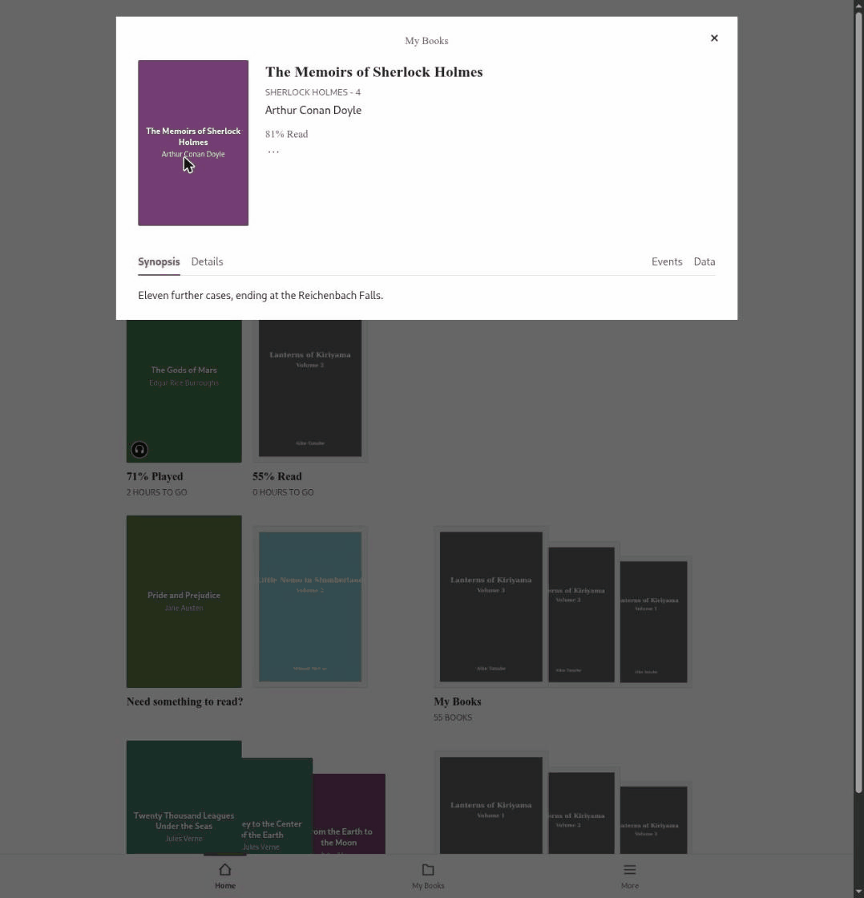

# Alexandria

Your own books and audiobooks on your Kobo, just like the ones you bought from the store.

Alexandria is a small self-hosted library for Kobo e-readers. Put your EPUBs, comics and audiobooks in a folder, and they show up on your Kobo with covers, series and reading progress. There's no USB and no sideloading. Your Kobo syncs the way it always does.

The web interface is designed to look and feel like the Kobo itself. It's "Kobo simple": calm, clean, and focused on your books rather than on settings.

As far as I know, Alexandria is the first project that lets you host your own audiobooks on a Kobo natively, with full tracking: listening progress, sessions and finished status flow back from the device, just like store audiobooks.

I started building Alexandria in March 2026, and it has run my own library on my own Kobo devices since early April 2026. That's about seven months of real-world use and testing before this public release.



*The tour uses generated seed data: public-domain titles with synthetic files, reading progress and devices. The demo books have no cover art, so Alexandria shows its placeholder covers. Your own books show their real covers.*

## Features

### On your Kobo

- **Ebooks**: EPUBs are converted to KEPUB automatically, so they open in the Kobo's own reader.
- **Audiobooks**: M4B files and folders of MP3 chapters play in the Kobo's audiobook player.
- **Comics**: CBZ and CBR files are turned into fixed-layout books that fit your device's screen.
- **Covers, series and authors**: books look the same as store purchases.
- **Reading progress**: progress and finished status sync both ways, so you can start on one Kobo and pick up on another. There is one set of progress per library: Alexandria is built for one reader with several Kobos, not for a family sharing one instance.
- **The Kobo store still works**: anything Alexandria doesn't handle is passed through to Kobo unchanged.

### Audiobookshelf sync

Already use [Audiobookshelf](https://www.audiobookshelf.org/) on your phone? Alexandria keeps your listening progress in sync both ways. Start an audiobook on your Kobo, continue on your phone, and pick it up on the Kobo where you left off.

- Two-way sync every 5 minutes. The most recent progress wins.
- Each Alexandria user connects their own Audiobookshelf account under **More → Integrations** with a server URL and API token.
- Books are matched by file name, so the same files in both libraries are all it takes.
- Every pull from and push to Audiobookshelf shows up in the book's activity log, next to your Kobo sessions.

### In the browser

- Designed to look like the Kobo: the same Home, My Books and More layout, with serif type and square, paper-like styling.
- Browse and search books, authors, series and collections.
- Edit titles, authors, series and covers. Changes are written back into your files.
- Sync your library on demand and watch it happen live.
- Manage devices, users and settings.
- Light and dark mode.

## Getting started

You need:

- An **x86-64 (amd64)** machine with Docker. ARM machines such as a Raspberry Pi aren't supported.
- A Kobo that's signed in to a Kobo account and on Wi-Fi that can reach that machine.
- Your books in folders. Alexandria only scans the **top level** of each folder: EPUB, CBZ and CBR files directly in the ebook folder, and M4B files or one subfolder of MP3 chapters per audiobook in the audiobook folder. A Calibre-style `Author/Title/book.epub` tree isn't picked up.

### 1. Run it

Make an empty folder, save this as `compose.yaml` in it, and change the two library paths and `PublicUrl`. The same file is in the repository as [`compose.yaml`](compose.yaml).

```yaml
services:
  alexandria:
    container_name: alexandria
    image: ghcr.io/sirbisgaard/alexandria:latest
    platform: linux/amd64
    ports:
      - 8080:8080
    user: 1000:1000
    restart: always
    volumes:
      - /path/to/your/ebooks:/books/ebooks
      - /path/to/your/audiobooks:/books/audiobooks
      - ./data:/data
    environment:
      # Address your Kobo uses to reach Alexandria, without a trailing slash (not localhost).
      # At home: http://<this machine's LAN IP>:8080. Away from home: an https:// address behind a reverse proxy.
      - AlexandriaSettings__PublicUrl=http://192.168.1.20:8080
      # Database, KEPUBs, transcoded chapters and comic renditions
      - AlexandriaSettings__DataFolder=/data
      # EPUB, CBZ and CBR files
      - AlexandriaSettings__EbookFolder=/books/ebooks
      # M4B files and folders of MP3 chapters
      - AlexandriaSettings__AudiobookFolder=/books/audiobooks
      # Initial M4B handling (only applied on first start; change it later under More → Settings → Audiobooks):
      #   Nothing          - convert chapters to MP3 when the Kobo asks for them (least disk, long chapters can time out)
      #   TranscodeAtIndex - convert chapters to MP3 once while indexing and keep the M4B (most disk, reliable)
      #   ConvertAtIndex   - turn the M4B into an MP3 folder while indexing and DELETE the M4B (best Kobo compatibility)
      - AlexandriaSettings__M4BFileTreatment=Nothing
      # Log level, from most to least output:
      #   Trace, Debug, Information, Warning, Error, Critical, None
      - Logging__LogLevel__Default=Information
```

Find your machine's LAN IP with `ip a` (Linux) or `ipconfig` (Windows). Keep the double underscores in the variable names: they're required. Then:

```sh
mkdir data
docker compose up -d
```

The container runs as user `1000:1000`, and it needs to be able to **write** to `./data` and to both library folders. If your files belong to another user, change `user:` to match (`id -u` and `id -g` show yours). See [Running on a server](docs/running-on-a-server.md) for permissions, HTTPS and reverse proxies.

> **What Alexandria does to your files.** Editing a book in the web UI writes the change into the file. A library sync repacks CBR comics as CBZ (the CBR is deleted), may add a `cover.jpg` to MP3 audiobook folders, and applies the M4B setting above. `ConvertAtIndex` **deletes each M4B** after converting it. If you're unsure, try it on a copy of your library first.

### 2. Sign in

Open `http://<your server>:8080` and sign in with username `alexander` and password `TheGreat`. **Change the password right away** under **More → Users**. Everyone who reads this README knows the default.

### 3. Index your library

Press the **sync** button in the top bar and then **Sync now**. Alexandria scans your folders, converts every EPUB to KEPUB (Kobo's own EPUB flavour, which gives page numbers and reading stats) and reads every audiobook. On a big library, the first run takes a while.

There are two kinds of sync. A **library sync** in the web UI makes Alexandria scan your folders. A **Kobo sync** on the device makes your Kobo fetch from Alexandria. Do a library sync first.

### 4. Connect your Kobo

1. In the web UI, open **More → Devices**, choose **Pair New Device**, give it a name, and copy the URL the dialog shows.
2. Connect the Kobo to your computer over USB. Open the `.kobo` folder on it. It's hidden: press Cmd+Shift+. in the macOS Finder, or turn on **View → Hidden items** in Windows Explorer.
3. Open `.kobo/Kobo/Kobo eReader.conf` in a plain-text editor (Notepad, TextEdit, not Word). Under `[OneStoreServices]`, find the existing `api_endpoint=https://storeapi.kobo.com` line and replace only the value with the URL you copied:

   ```conf
   [OneStoreServices]
   api_endpoint=http://192.168.1.20:8080/api/kobo/<device-key>
   ```

4. Save, eject the Kobo, and tap **Sync** on it.

Your library appears on the Kobo, and **More → Devices** shows its model and firmware. Books download when you tap them. To undo, put `https://storeapi.kobo.com` back.

**Back up `./data`.** It holds the IDs your Kobo knows your books by. Lose it, and your Kobo sees every book as new. See [Backups](docs/running-on-a-server.md#backups).

## Documentation

Everything beyond getting started lives in [`docs/`](docs/README.md):

- **[How it works](docs/how-it-works.md)**: the Kobo proxy, sync protocol, reading progress, indexing and editing.
- **[Running on a server](docs/running-on-a-server.md)**: configuration, permissions, reverse proxies, NAS setups, backups and troubleshooting.
- **[Building and contributing](docs/building-and-contributing.md)**: building from source, tests, conventions and releases.
- **[Audiobooks](docs/audiobooks.md)**, **[Comics](docs/comics.md)** and **[Audiobookshelf sync](docs/audiobookshelf.md)**.
- **[FAQ](docs/README.md#frequently-asked-questions)**.

## Thanks

- **[FFmpeg](https://ffmpeg.org/)** for everything audio.
- **[kepubify](https://pgaskin.net/kepubify/)** for EPUB to KEPUB conversion (bundled).
- **Kobo**, for making devices that are a pleasure to read on.

## Contributing

Issues, ideas and pull requests are welcome. Alexandria stays deliberately small: it manages your library, and the Kobo does the reading. Start with [Building and contributing](docs/building-and-contributing.md).

## Disclaimer

Alexandria is not associated with Rakuten Kobo Inc. in any way, and is not endorsed or supported by them.
Kobo is a trademark of Rakuten Kobo Inc. Audiobookshelf is a trademark of its respective owner.

Alexandria serves only files you provide. It does not remove or bypass DRM, does not download or copy Kobo store content, and does not modify your Kobo's firmware. Store purchases keep coming from Kobo. Pointing a Kobo at a third-party server may not be covered by Kobo's terms of service, so use it at your own risk.

### Use of LLMs (AI)

LLMs were used to write parts of this code. I review it, I test it, I'm responsible for it.

## License

[EUPL-1.2](./LICENSE). Third-party components and their licenses are listed in [THIRD_PARTY_NOTICES.md](THIRD_PARTY_NOTICES.md).
