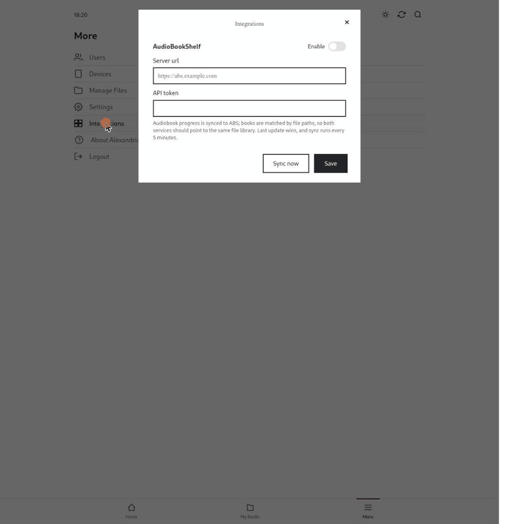

# Audiobookshelf sync

[Audiobookshelf](https://www.audiobookshelf.org/) is a popular self-hosted audiobook server with good phone apps. If you already use it, Alexandria can keep listening progress in sync between your Kobo and Audiobookshelf, in both directions. Listen on the Kobo at home, continue on your phone on the go, and the Kobo picks up where you left off.

- [Setting it up](#setting-it-up)
- [How books are matched](#how-books-are-matched)
- [How syncing works](#how-syncing-works)
- [What shows up in the activity log](#what-shows-up-in-the-activity-log)
- [Troubleshooting](#troubleshooting)

## Setting it up



You need the same audiobook files in both libraries. Pointing Alexandria and Audiobookshelf at the same folder is the easiest way.

1. In Audiobookshelf, open your user settings and create an **API token**.
2. In Alexandria, open **More → Integrations**. In the **Audiobookshelf** tile, turn on **Enable** and fill in:
   - **Server URL**: e.g. `https://abs.example.com`
   - **API token**
3. **Save.** With **Enable** on, Alexandria checks the connection right away (`GET /api/me`) and tells you if the URL or token is wrong. Saving with it off stores the values without checking them.

The token is stored in Alexandria's database in plain text and shown to signed-in users in this dialog. If you can, create a dedicated Audiobookshelf user for it.

The integration is **per Alexandria user**, so each person connects their own Audiobookshelf account. Reading progress in Alexandria is shared library-wide, though (see [Reading progress](how-it-works.md#reading-progress)), so it works best when one person's listening goes through each library.

## How books are matched

Books are matched by **file or folder name**: the whole name, including the extension, ignoring case.

- Alexandria's side uses the audiobook's folder name (MP3 folders) or `.m4b` file name, and each chapter's file name.
- Audiobookshelf's side uses the last part of the item's path: the folder or file Audiobookshelf has the book in.

In practice: an MP3 audiobook in folder `Jack London - White Fang` matches an Audiobookshelf item in a folder with exactly that name, and `The Time Machine.m4b` matches an item whose file is `The Time Machine.m4b`. The first name that matches wins. If both libraries see the same files, matching just works. Only Alexandria audiobooks that aren't archived take part.

## How syncing works

- A background job runs **every 5 minutes**, starting 5 minutes after Alexandria starts. It skips a round while a library sync or file management task is running.
- For every matched book that changed since the last round, **the newest side wins**:
  - **Audiobookshelf newer → pull.** Alexandria takes over the progress: *Finished* if Audiobookshelf says finished, *Reading* if progress is above 0, otherwise *Unread*. The position is placed inside the right chapter, so the Kobo opens at the right spot.
  - **Alexandria newer → push.** Alexandria opens a one-second listening session in Audiobookshelf at the new position (percentage × duration) and closes it again, and marks the item finished if it's finished. Those short sessions show up in Audiobookshelf's listening stats.
  - "Newer" on Alexandria's side is the time Alexandria last saved the book's progress, not the time the Kobo reported.
- A pull updates Alexandria's reading progress, so **every Kobo** gets it on its next sync.
- **Echo protection.** The last-synced time is only recorded after the whole round is done, so a change Alexandria just pushed isn't pulled back in the next round, and the other way around.
- **Removed in Audiobookshelf.** If Audiobookshelf drops the progress for a book that was synced before, Alexandria deletes its local progress for that book too, and logs that.
- **Several users.** Each user's integration syncs against Alexandria's one shared progress per book. Two people with different Audiobookshelf accounts listening to the same book will overwrite each other's progress.
- **Sync now** runs a round immediately and ignores the "changed since last round" filter, so every matched book is reconciled again: more short sessions in Audiobookshelf and more rows in the Events tabs. It reports *Synced* even if Audiobookshelf couldn't be reached. Errors only show up in the logs and `exceptions.log`.

## What shows up in the activity log

Every pull and push is logged in the book's **Events** tab, merged into sessions like Kobo listening sessions. Updates for the same book at most 37 minutes apart extend one row:

```
Pulled "Treasure Island" ← ABS at 37.8% · session 19m
Pushed "Treasure Island" → ABS at 41.2% · session < 5m
```

Any other event in between (Kobo playback, for example) starts a new row.

## Troubleshooting

| Problem | Fix |
|---|---|
| Saving fails with a connection error | The server URL must be reachable *from the Alexandria container*, and absolute (`https://…`). Check the token |
| A book never syncs | The file or folder names differ between the libraries, extension included. Make them match, or point both at the same folder |
| Nothing syncs, but *Sync now* says *Synced* | Audiobookshelf is unreachable, or the token stopped working. Check `docker compose logs` and `exceptions.log` |
| Progress jumps back | Two places moved the same book within one round, and the newest won. Give it a round (5 minutes) and check the Events tab to see which side won |
| Pushes are skipped | The audiobook has no known duration. Run a library sync so Alexandria reads it |
