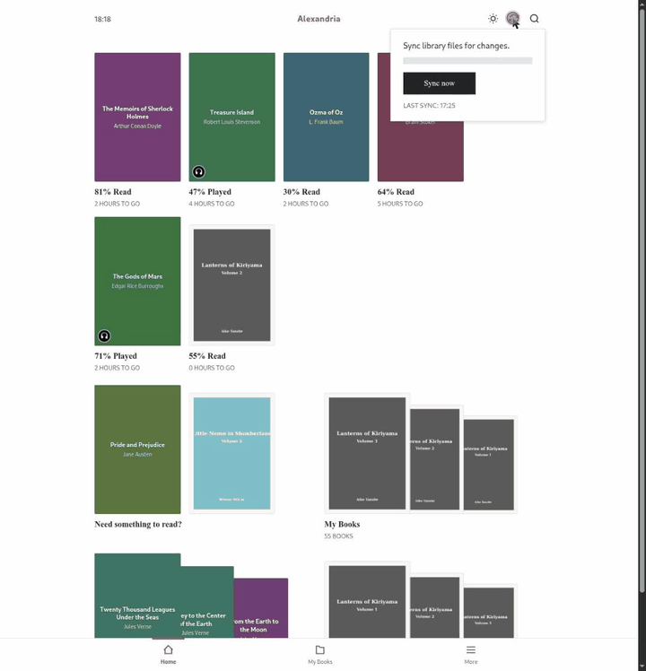
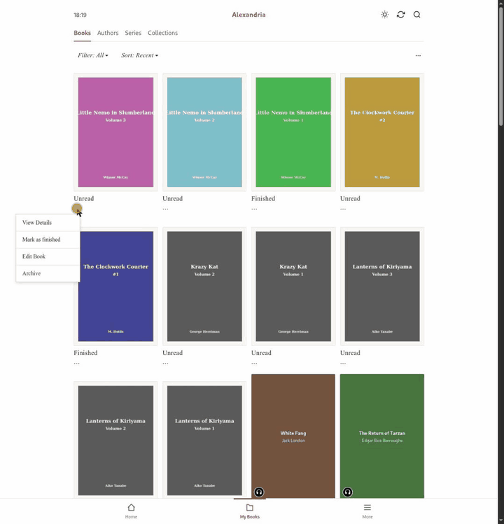

# How Alexandria works

Alexandria makes your own files look like store purchases to a Kobo. This page explains how: the proxy trick, the sync protocol, how books get their identity, how progress travels between devices, and what happens to your files on the way.

- [The big picture](#the-big-picture)
- [Connecting a Kobo](#connecting-a-kobo)
- [The proxy: intercept or pass through](#the-proxy-intercept-or-pass-through)
- [Library sync](#library-sync)
- [Reading progress](#reading-progress)
- [The activity log](#the-activity-log)
- [Indexing your library](#indexing-your-library)
- [Book identity](#book-identity)
- [Editing metadata](#editing-metadata)
- [Covers](#covers)
- [Archiving and removing books](#archiving-and-removing-books)
- [File management](#file-management)
- [Recommendations and the Home screen](#recommendations-and-the-home-screen)
- [The web interface](#the-web-interface)
- [What's stored where](#whats-stored-where)

Media-specific details have their own pages: [Audiobooks](audiobooks.md), [Comics](comics.md) and [Audiobookshelf sync](audiobookshelf.md).

## The big picture

A Kobo talks to the Kobo store at `storeapi.kobo.com` to find out what's in your library, download books and save your reading progress. Every Kobo reads the store's address from a config file, and you can change it.

Alexandria sits in that spot. You point the Kobo at Alexandria, and Alexandria:

1. **Passes through** everything it doesn't need to handle to the real Kobo store, so your account, purchases, the store and firmware updates keep working.
2. **Intercepts** the few requests that matter (library sync, downloads, covers, reading progress, analytics) and adds your own books to the answers.

```
            ┌────────────────────────────────── Alexandria ──────────────────────────────────┐
  Kobo ───► │  /api/kobo/<device-key>/...                                                     │
            │     ├── intercepted: sync, downloads, covers, state, analytics, products  ──► your library
            │     └── everything else  ────────────────────────────────────────────────────► storeapi.kobo.com
            └─────────────────────────────────────────────────────────────────────────────────┘
```

The Kobo treats them like store books. To it, your EPUBs, comics and audiobooks are just more books in the account, with the same shelves, progress bars, series grouping and audiobook player.

## Connecting a Kobo

Every Kobo has `.kobo/Kobo/Kobo eReader.conf` on its USB storage. The `[OneStoreServices]` section has an `api_endpoint`:

```conf
[OneStoreServices]
api_endpoint=https://alexandria.example.com/api/kobo/<device-key>
```

The device key is a GUID that Alexandria generates when you pair a device under **More → Devices**. It's both the device's address and its credential:

- The first time the key is used, Alexandria records the Kobo's **serial number** (`x-kobo-deviceid` header) and reads the **model and firmware** from its user agent (`Kobo Touch 0390/4.45.23684` → Kobo Libra Colour, firmware 4.45.23684).
- If a request later arrives with that key from a *different* serial, the key is **locked** and every request gets `401` until you unlock it in the web UI. A leaked config file can't be reused on another Kobo. The check relies on the serial header the Kobo sends, so it doesn't stop a script that leaves the header out, and the key itself remains the credential.
- A key that isn't registered, or isn't a GUID, also gets `401`.
- Cover images are the exception: they're served without a key check, because the cover IDs can't be guessed.
- When a newly paired Kobo connects for the first time and its screen size is one Alexandria hasn't seen before, a library sync starts so comic renditions get built for it (see [Comics](comics.md)).

A trailing slash on `api_endpoint` is fine. Alexandria collapses the double slash it causes.

## The proxy: intercept or pass through

All Kobo traffic arrives at `/api/kobo/{device-key}/...`. Explicit routes handle what Alexandria owns, and a catch-all route forwards the rest.

### Passing through

Requests Alexandria doesn't handle are sent to `https://storeapi.kobo.com` with the same path, query and body:

- Hop-by-hop headers (`Connection`, `Transfer-Encoding`, `Host`, …) are dropped, and Alexandria's own cookies are stripped.
- Redirects are **not** followed by Alexandria. They're passed back to the Kobo, which follows them itself.
- Gzip-compressed responses are decompressed before being returned.
- Header lookups ignore case. That sounds trivial, but a single case-sensitive lookup on the sync token header once made every sync resend the whole library.

Signing in (`/v1/auth/device`) is always passed through, so the Kobo gets a real token from Kobo for your account.

### Initialization

When a Kobo starts a sync, it asks `/v1/initialization` for a list of resource URLs. Alexandria fetches the real list from Kobo and rewrites exactly four entries to point back at itself:

| Resource | Rewritten to |
|---|---|
| `library_sync` | `{PublicUrl}/api/kobo/{key}/v1/library/sync` |
| `image_host` | `{PublicUrl}/api/kobo/{key}` |
| `image_url_template` | `{PublicUrl}/api/kobo/{key}/{ImageId}/{Width}/{Height}/false/image.jpg` |
| `image_url_quality_template` | the same, with `/{Quality}` |

Everything else (store pages, account, Kobo Plus, …) keeps pointing at Kobo.

### Intercepted endpoints

For local books, Alexandria answers itself. An ID it doesn't recognise is forwarded to Kobo, so store books keep working through the same endpoints.

| Endpoint | What Alexandria does |
|---|---|
| `GET v1/library/sync` | Merges the store's sync results with your local books (next section) |
| `GET download/{id}/kepub` (and `/epub`) | Ebooks: the KEPUB file. Comics: the rendition built for *this* device's screen |
| `GET download/{id}/manifest` | Audiobook manifest: the chapter list with a URL per chapter |
| `GET audiobook/{id}/chapter/{n}` | Streams one chapter as `audio/mpeg` |
| `GET {imageId}/{w}/{h}[/{q}]/{grey}/image.jpg` | Cover at the requested size. Unknown covers redirect to Kobo's CDN |
| `GET`/`PUT v1/library/{id}/state` | Reading progress |
| `GET v1/library/{id}/metadata` | Book metadata |
| `DELETE v1/library/{id}` | "Remove from device" archives the book |
| `GET v1/products/books/series/{id}` | Other books in the series, from your library |
| `GET v1/products/{id}/recommendations` | Up to five picks from your library, of the same media type: next in series, then same author, then shared subjects, then random |
| `GET v1/products/books/{id}`, `v1/products/audiobooks/{id}` | Product details for local books |
| `GET v1/products/{id}/nextread` | Empty for local books |
| `GET v1/products/{ids}/prices` | Local books cost 0. If none of the IDs is local, the request goes to Kobo |
| `GET v1/user/recommendations` | Empty, so the store's ads don't fill your home screen |
| `POST v1/analytics/event` | Records local books' events in the activity log, and forwards store events to Kobo |

## Library sync

A Kobo syncs by calling `GET v1/library/sync` again and again with a **sync token**, until the server stops saying `x-kobo-sync: continue`. Each response is a batch of changes.

### The sync token

Alexandria wraps Kobo's own token in its own: a base64 JSON blob holding Kobo's token and the time of this device's last successful sync with Alexandria. Only Kobo's part is forwarded to the store. A token Alexandria can't read, after a factory reset for example, is treated as a plain Kobo token, which starts a full sync.

### Two phases

1. **Store phase.** The request goes to Kobo first. While Kobo says `continue`, its results are passed straight through. The store's collections (shelves) are copied into Alexandria.
2. **Local phase.** When the store is done, Alexandria works out which local books this device needs to hear about:
   - books changed since the device's last sync,
   - books never sent to this device,
   - books whose reading progress changed since the last sync.

   They're sent in batches of **Sync batch size** (default 60), and `continue` keeps the Kobo asking until all batches are delivered. Collections are sent in the last batch, so empty shelves don't flash up first.

The batching state lives in memory per device and expires after five minutes. If Alexandria restarts in the middle of a sync, the Kobo just syncs again.

### What gets sent per book

Alexandria remembers which version of each book it sent to each device (`KoboDeviceSyncedFiles`) and picks one action per book:

| Situation | Sent to the Kobo |
|---|---|
| New to this device | `NewEntitlement`, including reading progress |
| Archived, and on this device | `ChangedEntitlement` with `IsRemoved: true`. The Kobo removes it |
| Changed since it was sent (metadata, cover, file) | Remove, then re-add as a `NewEntitlement`, then a separate `ChangedReadingState` |
| Only reading progress changed | A bare `ChangedReadingState` |
| Unchanged, but in the batch | `ChangedEntitlement` + `ChangedReadingState` |

Two Kobo quirks shape this table, both found by testing on real devices:

- **The Kobo ignores in-place metadata updates** for books it already has. To show a new title or cover, the book has to be removed and added again in the same sync.
- **The Kobo ignores reading progress inside an entitlement** for books it already has. Progress only lands when it comes as its own `ChangedReadingState` item.

Each book is described with the same JSON shapes the store uses:

- Ebooks are `BookEntitlement` + `KEPUB`.
- Comics are `BookEntitlement` + `EPUB3FL`, the fixed-layout format that opens the Kobo's comic reader.
- Audiobooks are `AudiobookEntitlement` + `MANIFEST`.

When the same work exists as both an ebook and an audiobook, both share a `RelatedGroupId`, so the Kobo knows they belong together.

Comics that don't have a rendition for the requesting device's screen yet are held back and offered again on the next sync.

## Reading progress

Progress is stored **once per book**, not per user or per device, in `KoboReadingStates`. Every paired Kobo reads and writes the same record.

- **From a Kobo.** When you read, the Kobo `PUT`s its state. Alexandria keeps the newest version by `LastModified`. An older update is accepted with `200` but ignored, because the Kobo doesn't retry. Fields the Kobo leaves out keep their stored values. The "times started" counter only goes up when a book moves into *Reading*.
- **To the other Kobos.** Because the record's modified time is now newer than the other devices' last sync, they receive the update as a `ChangedReadingState` on their next sync. Start a book on one Kobo and continue on another.
- **From the activity log.** Analytics events move progress too: *Mark as finished* sets Finished / 100 %, *Mark as unread* resets to 0 %, audiobook playback and ebook open/close events update the percentage and set *Reading* (unless the book is already finished).
- **From the web UI.** Setting a status by hand (*Reading*, *Finished*, *Unread*) writes the state immediately. *Finished* is 100 % and *Unread* is 0 % with the position cleared. It also marks the book itself as changed, so on their next sync, Kobos remove and re-add the book together with the new state.
- **From Audiobookshelf.** See [Audiobookshelf sync](audiobookshelf.md).

## The activity log

Kobos send analytics events while you read and listen: opening and closing a book, page turns, playback start and pause, speed changes, marking finished. For your own books, Alexandria stores these in `BookActivityEvents` and shows them in each book's **Events** tab. Store books' events are forwarded to Kobo as usual.

- Duplicates are ignored, because Kobos resend events after a failed upload.
- Ebook rows read like *Opened ebook at 41% (from Home)* and *Closed ebook at 47% — read 1520s, 28 pages turned*.
- **Listening sessions are grouped.** A run of player events from one device (start, pause, player screen, chapter list, speed change) becomes one row: *Listened 3h 9m · 0.0% → 10.4% · session 3h 23m*. A pause followed by more than 37 minutes of silence ends the session. Grouping happens when the log is shown, and the raw events are kept.
- Audiobookshelf pulls and pushes show up as their own merged session rows.
- **More → Settings → General → Kobo Book Analytics + Other → Clear** deletes the whole log.

## Indexing your library



Indexing reads your folders and brings the database in line with them. It runs when you press sync in the web UI, at startup if **Sync library at boot** is on, and automatically when a Kobo with a new screen size connects for the first time. Only one library task (indexing or file management) runs at a time, and progress streams live to every open browser.

The steps, in order:

1. **Converters run first.** CBR comics are repacked as CBZ. With `ConvertAtIndex`, M4B audiobooks become MP3 folders. See [Comics](comics.md) and [Audiobooks](audiobooks.md).
2. **Discovery**, top level only:
   - `*.epub` and `*.cbz` directly in the ebook folder.
   - `*.m4b` directly in the audiobook folder.
   - Every direct subfolder of the audiobook folder that contains `*.mp3` files is one audiobook.
3. **Per file:** if the file's modified time, metadata and cover haven't changed, a fast path skips it. Otherwise metadata and cover are read and derivative files are built: a KEPUB for ebooks, chapter MP3s with `TranscodeAtIndex`, one rendition per device screen for comics.
4. **Matching to known books:** first by path, then by identical metadata at a path that disappeared (so a moved or renamed file keeps its identity), and only then as a new book.
5. **Clean-up:** books whose files are gone are removed, along with authors and series that no longer have books.

Ebooks are converted to KEPUB with the bundled [kepubify](https://pgaskin.net/kepubify/), which gives the Kobo's native reader page numbers, reading stats and proper typography. Audiobooks are read with `ffprobe`, and comics with ImageMagick.

Heavy work is capped at `min(8, 80 % of CPU cores)` parallel jobs. Without that cap, dozens of ffmpeg processes reading one big file from a NAS failed at random.

## Book identity

Every book has two IDs:

- **`BookUuid`**, Alexandria's own ID: a UUID v5 derived from the book's title, authors, media type and narrators, inside a namespace unique to your install (the random `UuidSeed` created with the database).
- **`EntitlementUuid`**, the ID the **Kobo** knows the book by. It's random, created once, and never changes.

When you edit a book's title or authors, or rename or move its file, both IDs are carried over. The Kobo sees the same book with new details, not a new book.

This is why the database matters for backups: lose it, and every book gets new IDs, so your Kobos see a library full of new books. See [Backups](running-on-a-server.md#backups).

## Editing metadata



Your files are the source of truth. When you edit a book in the web UI:

1. The change is written **into the file** if it differs from what's there: the OPF for EPUBs, tags via ffmpeg for M4Bs, ID3 tags on every file of an MP3 folder, `ComicInfo.xml` for CBZs. Audio and comic files are written to a temporary file next to the original and then swapped in.
2. The file is indexed again, keeping its IDs and creation date.
3. Fields a format can't hold (a comic's colour mode, for example) are kept in the database.
4. The book's modified time moves forward, so every Kobo gets the update on its next sync, as a remove + re-add, because of the quirk above.

Comic covers are always the first page and can't be replaced.

## Covers

- Covers are extracted at index time into `covers/{BookUuid}.jpg`, and resized versions are cached per requested size.
- The Kobo caches covers by their URL. To make a new cover show up, the cover ID sent to the Kobo is derived from the book's ID **plus its modified time**, so every edit produces a new URL and the Kobo fetches the new picture.
- Cover requests for books Alexandria doesn't know are redirected to Kobo's image CDN, so store covers keep working.
- A Kobo can keep showing the old cover in its *Currently reading* area until it restarts.

## Archiving and removing books

Choosing **Remove** on the Kobo (`DELETE v1/library/{id}`) doesn't delete anything. Alexandria marks the book **archived**. On the next sync, every device that has it is told to remove it. Archived books are left out of recommendations and Audiobookshelf sync. Archived books stay visible in the web UI with an *Archived* label. **Unarchive** in the book's menu sends it to your devices again as new.

Deleting a file from disk removes the book from Alexandria at the next index, but **not from your Kobos**. Once the book is gone from Alexandria, it can't tell the devices to remove it. To delete a book everywhere, archive it in the web UI first, let each Kobo sync, and only then delete the file.

## File management

**More → Manage Files** renames your files to match their metadata, using the **Filename template** from Settings:

```
<Authors> - (<Serie> #<SerieIndex> - )<Title>
```

- Tokens are `<Authors>`, `<Title>`, `<Serie>`, `<SerieIndex>`, `<Narrator>` (the first narrator) and `<Narrators>` (all of them).
- A `( … )` group disappears when any token inside it is empty, so books without a series get `Author - Title`.
- Names are capped at 200 characters.
- MP3 chapter files are renamed to `NN - Book title.mp3`, numbered in chapter order.

You always get a **dry run** first: the planned renames, the skipped files, and conflicts (two books wanting the same name, or the target already existing). The real run plans again, refuses to start while there are conflicts, and rolls back a rename if the database update for it fails. Book identity isn't touched, so your Kobos don't notice.

## Recommendations and the Home screen

The web UI's Home screen mirrors the Kobo's:

- **Currently reading:** up to six books with status *Reading*, most recent first, with percentage and time left.
- **Need something to read?:** one or two unread books, picked from a hash of today's date, so the picks change daily and are the same for everyone.
- **My Books**, an **author spotlight** (the author with the most unread books), the **latest series**, and your **first collection**.

On the Kobo itself, the *recommendations* row under a book shows up to five books of the same media type from your own library (next in series, same author, shared subjects), never store ads.

## The web interface

- A single-page app in plain JavaScript (jQuery + Bootstrap), styled after the Kobo: serif type, square corners, and the same Home / My Books / More layout.
- **Sign-in:** username and password, hashed with PBKDF2-SHA256 (600,000 iterations). Sessions are signed tokens that last **7 days**. Deleting a user ends their sessions immediately. Changing a password does not.
- **One shared library.** Every user sees and manages the same books, devices and reading progress. There are no roles. Integrations like Audiobookshelf are per user.
- **Caching:** library lists come with ETags derived from the library's current state, so the browser only downloads them again when something changed.

## What's stored where

`{DataFolder}`:

| Path | Contents | If deleted |
|---|---|---|
| `alexandria.db` (+ `-wal`, `-shm`) | Everything: books, IDs, `UuidSeed`, reading progress, devices, users, collections, activity, settings | **Gone for good.** Restore from backup |
| `covers/` | Extracted covers and resized versions | Rebuilt by the next sync |
| `kepubs/` | KEPUB versions of your EPUBs | Rebuilt by the next sync |
| `chapters/` | Pre-built MP3 chapters (`TranscodeAtIndex`) | Served on the fly until rebuilt by the next sync |
| `comics/{screen-profile}/` | Fixed-layout EPUB renditions per Kobo screen | Rebuilt by the next sync |
| `exceptions.log` | Errors with stack traces | Recreated |

Your library folders only ever contain your own files, plus files Alexandria creates there: CBZs that replace CBRs, MP3 folders from `ConvertAtIndex`, `cover.jpg` in MP3 audiobook folders, and `alexandria-conversion-failed/` folders for files that couldn't be converted (see [Audiobooks](audiobooks.md) and [Comics](comics.md)).
