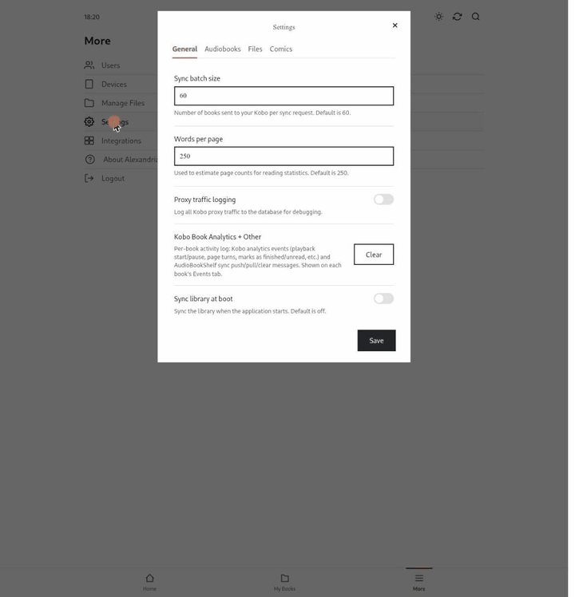
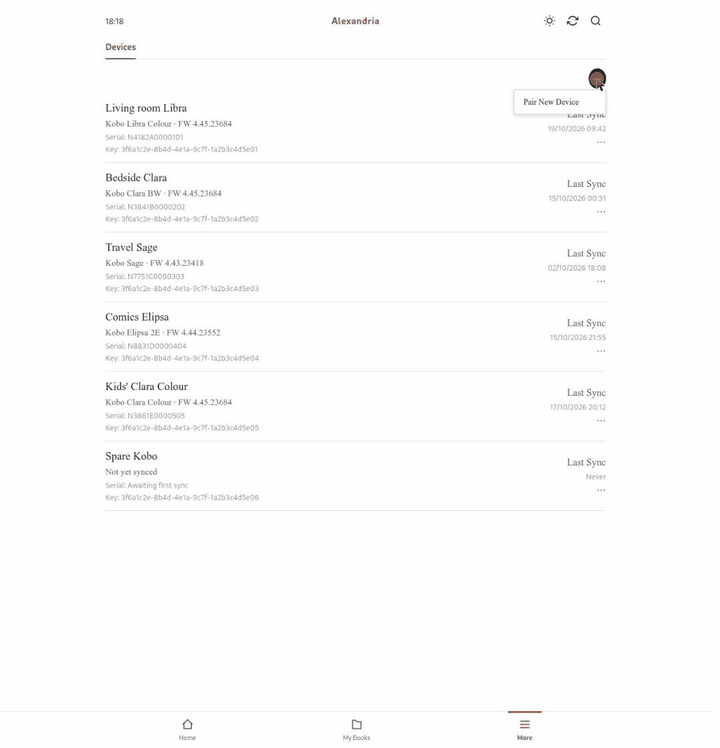

# Running Alexandria on a server

This page covers running Alexandria for real: on a home server or NAS, behind a reverse proxy, kept up to date and backed up.

- [What you need](#what-you-need)
- [Docker Compose](#docker-compose)
- [Folders and permissions](#folders-and-permissions)
- [Configuration reference](#configuration-reference)
- [Networking: PublicUrl, HTTPS and reverse proxies](#networking-publicurl-https-and-reverse-proxies)
- [First start](#first-start)
- [Devices and users](#devices-and-users)
- [Upgrading and rolling back](#upgrading-and-rolling-back)
- [Backups](#backups)
- [Logs and monitoring](#logs-and-monitoring)
- [Performance and resources](#performance-and-resources)
- [Running on a NAS](#running-on-a-nas)
- [Security](#security)
- [Troubleshooting](#troubleshooting)

## What you need

- A machine that runs Docker on **linux/amd64**. The image is built for amd64 only. On an ARM machine, `platform: linux/amd64` falls back to QEMU emulation, which is too slow for transcoding, so don't.
- **Outbound HTTPS to `storeapi.kobo.com`.** Every Kobo sync starts with the Kobo store, so there's no offline mode. If you use [Audiobookshelf sync](audiobookshelf.md), the container also needs to reach your Audiobookshelf server.
- Your library on a disk or share the container can **write** to (see [permissions](#folders-and-permissions)).
- An address your Kobo can reach: a LAN IP, a local DNS name, or a public domain.

Everything else (ffmpeg, ffprobe, kepubify, ImageMagick) is inside the image.

## Docker Compose

The canonical file is [`compose.yaml`](../compose.yaml) in the repository. It's the same as the one in the README:

```yaml
services:
  alexandria:
    container_name: alexandria
    image: ghcr.io/sirbisgaard/alexandria:latest
    platform: linux/amd64
    ports:
      - 8080:8080
    user: 1000:1000
    restart: always
    volumes:
      - /path/to/your/ebooks:/books/ebooks
      - /path/to/your/audiobooks:/books/audiobooks
      - ./data:/data
    environment:
      - AlexandriaSettings__PublicUrl=http://192.168.1.20:8080
      - AlexandriaSettings__DataFolder=/data
      - AlexandriaSettings__EbookFolder=/books/ebooks
      - AlexandriaSettings__AudiobookFolder=/books/audiobooks
      - AlexandriaSettings__M4BFileTreatment=Nothing
      - Logging__LogLevel__Default=Information
```

```sh
mkdir -p data
docker compose up -d
docker compose logs -f alexandria
```

- **Tags.** Every release is published as `ghcr.io/sirbisgaard/alexandria:<YYYYMMDDnn>` (e.g. `2026101901`), and `:latest` points at the newest. Pin a release tag if you want to choose when to upgrade. Database migrations only go forward (see [rolling back](#upgrading-and-rolling-back)), so with `:latest` and an auto-updater or `pull_policy: always`, every redeploy can upgrade you without asking.
- **Port.** The container listens on **8080** (the .NET base image default, `ASPNETCORE_HTTP_PORTS`). With `network_mode: host`, set `ASPNETCORE_HTTP_PORTS` to pick another port.
- **Binding.** `8080:8080` publishes on every interface and bypasses host firewalls like ufw. If a reverse proxy runs on the same host, use `127.0.0.1:8080:8080` so only the proxy can reach it.
- **Log rotation.** Docker's default log driver never rotates. Add:

  ```yaml
      logging:
        options:
          max-size: "10m"
          max-file: "3"
  ```

## Folders and permissions

| Container path | What's in it | Access needed |
|---|---|---|
| `/data` (`DataFolder`) | `alexandria.db` (+ `-wal`/`-shm`), `exceptions.log`, `covers/`, `kepubs/`, `chapters/`, `comics/` | Read/write, **on a local filesystem** |
| `/books/ebooks` (`EbookFolder`) | EPUB, CBZ and CBR files, **directly in this folder** (subfolders aren't scanned) | Read/write |
| `/books/audiobooks` (`AudiobookFolder`) | `.m4b` files directly in this folder, and one subfolder of `.mp3` chapters per audiobook | Read/write |

**`/data` must be local storage**: a local disk, a ZFS dataset or a Docker volume, never NFS, SMB or CIFS. The database runs in SQLite's WAL mode, which relies on shared memory and file locking that network filesystems don't provide reliably. The result is lock errors or silent corruption. The library folders can live on a share.

**Why the library needs write access:** Alexandria treats your files as the source of truth and writes into them.

- Editing metadata or a cover in the web UI embeds the change into the EPUB, M4B, MP3s or CBZ. Audio and comic files are written to a temporary file next to the original and then moved into place, so the *directory* must be writable too, not just the files.
- Every library sync repacks CBR comics as CBZ and **deletes the CBR**, and may copy an image to `cover.jpg` in MP3 audiobook folders.
- `M4BFileTreatment=ConvertAtIndex` creates an MP3 folder next to each M4B and **deletes the M4B**.
- File management (**More → Manage Files**) renames files.

With a read-only library mount, browsing and syncing to the Kobo still work, but edits, conversions and renames fail.

**User IDs.** The compose file runs the container as `1000:1000`. Without `user:`, the image's built-in `app` user (uid 1654) is used. There are no `PUID`/`PGID` variables: `user:` is the only setting.

- Create `./data` yourself before the first start. If Docker creates it, it's owned by root, and the container exits immediately with an access error.
- Prefer setting `user:` to the owner of your existing library (`ls -n` shows the numeric IDs) over `chown -R`. That matters most if Calibre or Audiobookshelf use the same files.
- On TrueNAS SCALE, apps conventionally run as `568:568` (`apps`). Use `user: 568:568` and give `apps` write access in the datasets' ACLs.

## Configuration reference

### Environment variables

| Variable | Required | Values | Meaning |
|---|---|---|---|
| `AlexandriaSettings__PublicUrl` | yes | URL, **no trailing slash** | The address your Kobo uses to reach Alexandria. It's embedded in every download, cover and audiobook URL sent to the device, so it must work *from the Kobo*, never `localhost` |
| `AlexandriaSettings__DataFolder` | yes | path | Database and generated files |
| `AlexandriaSettings__EbookFolder` | yes | path | EPUB, CBZ, CBR |
| `AlexandriaSettings__AudiobookFolder` | yes | path | M4B files and MP3 folders |
| `AlexandriaSettings__M4BFileTreatment` | no (default `Nothing`) | `Nothing`, `TranscodeAtIndex`, `ConvertAtIndex` | Initial M4B handling. **Only read when the database is first created.** Change it in Settings afterwards. See [Audiobooks](audiobooks.md) |
| `Logging__LogLevel__Default` | no | `Trace`, `Debug`, `Information`, `Warning`, `Error`, `Critical`, `None` | Console log level |
| `TZ` | no | e.g. `Europe/Copenhagen` | Only affects timestamps in `exceptions.log`. Everything else is stored in UTC and shown in the browser's time zone |

Variable names are case-insensitive, but the double underscores are required. Any other ASP.NET Core setting can be passed the same way, e.g. `Logging__LogLevel__Microsoft.AspNetCore=Warning`.

### Settings in the web UI

Everything else lives in the database and is changed under **More → Settings**:



| Tab | Setting | Default | Meaning |
|---|---|---|---|
| General | Sync batch size | 60 | Books sent to a Kobo per sync request. Lower it if a slow device struggles with big syncs |
| General | Words per page | 250 | Used to estimate page counts and reading time |
| General | Proxy traffic logging | off | Record all Kobo traffic. Debugging only, see [Security](#security) |
| General | Kobo Book Analytics + Other | — | **Clear** deletes every book's activity log |
| General | Sync library at boot | off | Index the library every time the container starts |
| Audiobooks | M4B file treatment | from env | See [Audiobooks](audiobooks.md) |
| Files | Filename template | `<Authors> - (<Serie> #<SerieIndex> - )<Title>` | Used by file management to rename files |
| Comics | Comic rendering | — | How comics are prepared for each Kobo. See [Comics](comics.md) |

## Networking: PublicUrl, HTTPS and reverse proxies

The Kobo talks to Alexandria in two ways:

1. **API calls** to the `api_endpoint` you set on the device: `…/api/kobo/<device-key>`.
2. **Downloads, covers and audiobook chapters**, using URLs Alexandria builds from `PublicUrl`.

Both must reach the same instance. If the Kobo syncs but downloads fail, or covers stay blank, `PublicUrl` is almost always the problem.

### HTTP or HTTPS?

On a home network, plain HTTP to a LAN address works (`http://192.168.1.20:8080`), and Alexandria was developed that way. To sync away from home, put Alexandria behind a reverse proxy with a **publicly trusted certificate** (Let's Encrypt or similar) and use the `https://` address everywhere. The Kobo can't import your own CA, so self-signed and private-CA certificates don't work. Don't expose plain HTTP to the internet: the device key in the URL is the device's credential.

### Reverse proxies

Alexandria doesn't read `X-Forwarded-*` headers and doesn't need to. It builds every URL from `PublicUrl`, so the proxy only has to forward requests. What matters:

- **No response buffering, and long timeouts.** With `M4BFileTreatment=Nothing`, audiobook chapters are converted while the Kobo downloads them, so a response can take a while to start and then streams. The web UI's live sync progress is a server-sent event stream, which also needs buffering off.
- **Uploads.** Cover uploads are limited to Kestrel's default 30 MB, so a proxy limit of 30–50 MB is plenty.
- **Cloudflare.** Cloudflare's proxy (orange cloud) closes requests that take more than 100 seconds to start. That breaks long on-the-fly chapter conversions. Use DNS-only, or use `TranscodeAtIndex`/`ConvertAtIndex`.

Caddy (with Caddy on the same compose network as `alexandria`):

```caddy
alexandria.example.com {
    reverse_proxy alexandria:8080 {
        flush_interval -1
    }
}
```

nginx:

```nginx
server {
    server_name alexandria.example.com;
    listen 443 ssl;
    # ssl_certificate ...

    client_max_body_size 50m;

    location / {
        proxy_pass http://127.0.0.1:8080;
        proxy_http_version 1.1;
        proxy_buffering off;
        proxy_read_timeout 600s;
        proxy_send_timeout 600s;
    }
}
```

Traefik doesn't buffer responses by default, so a plain router and service is enough.

A trailing slash in the Kobo's `api_endpoint` is fine: Alexandria collapses double slashes in request paths. A trailing slash in `PublicUrl` is not.

### Exposing only what the Kobo needs

The web UI and the Kobo API share one port. To sync away from home, only `/api/kobo/*` has to be public. The web UI (`/` and `/api/alexandria/*`) has no login rate limiting, and every account is an administrator, so keep it on your LAN or VPN:

```caddy
alexandria.example.com {
    @kobo path /api/kobo/*
    handle @kobo {
        reverse_proxy alexandria:8080 {
            flush_interval -1
        }
    }
    @lan remote_ip private_ranges
    handle @lan {
        reverse_proxy alexandria:8080 {
            flush_interval -1
        }
    }
    respond 403
}
```

```nginx
location /api/kobo/ {
    proxy_pass http://127.0.0.1:8080;
    proxy_buffering off;
    proxy_read_timeout 600s;
}
location / {
    allow 192.168.0.0/16;
    allow 10.0.0.0/8;
    deny all;
    proxy_pass http://127.0.0.1:8080;
    proxy_buffering off;
}
```

If you do expose the web UI, put a login rate limiter in front of `POST /api/alexandria/auth/login` (fail2ban, CrowdSec, or your proxy's rate limiting). Forward-auth (Authelia, Authentik, …) can protect the web UI paths, but never `/api/kobo/*`: the Kobo can't log in.

### DNS

Your Kobo has to resolve the name in `PublicUrl`. With a name that only exists on your LAN (split-horizon DNS), syncing works at home and fails everywhere else. That's fine if that's what you want. To sync away from home, the name has to resolve publicly too.

## First start

1. `mkdir -p data && docker compose up -d`, then open `http://<server>:8080`.
2. Sign in as `alexander` / `TheGreat` and **change the password immediately** under **More → Users**. Everyone can read these defaults in the README.
3. Create accounts for anyone else who should manage the library.
4. Run a **library sync** from the top bar (**Sync now**). The first run converts every EPUB to KEPUB and reads every audiobook, so it takes a while on a big library. Progress streams live in the UI. Comic renditions are built once a Kobo has connected (next section).
5. Pair your Kobo devices.

## Devices and users

### Pairing a Kobo



1. **More → Devices → ··· → Pair New Device.** Give it a nickname, press **Next**, and copy the URL the dialog shows.
2. Connect the Kobo over USB. Open `.kobo/Kobo/Kobo eReader.conf` (the `.kobo` folder is hidden) in a plain-text editor, and replace only the value of `api_endpoint` in `[OneStoreServices]`:

   ```conf
   api_endpoint=https://alexandria.example.com/api/kobo/<device-key>
   ```

3. Eject and sync. The model, firmware and serial number show up in the device list after the first sync.

Pair every Kobo separately, so each gets its own key. The first time a key is used, it's tied to that Kobo's serial number. If another **Kobo** later uses the same key, the key is **locked** and stops working until you unlock it in the device list. The lock relies on the serial number the Kobo sends, so it stops other Kobos, not a script that leaves the header out. Treat the key as a password anyway.

**Disconnecting a Kobo.** Putting `https://storeapi.kobo.com` back in `api_endpoint` doesn't remove your Alexandria books from the device, because the real store never tells it to. To clean up first, archive the books in the web UI and sync the Kobo once, then revert the line. Or sign out of the Kobo account on the device, which wipes its library.

### Users

- All users manage the **same library**. There are no roles: every user can edit books, pair devices and manage users, including resetting other users' passwords. You can't delete yourself or the last user.
- Reading progress belongs to the library, not to a user. It's shared by every Kobo paired with this instance.
- Integrations such as [Audiobookshelf](audiobookshelf.md) are set up per user.
- Sessions last **7 days**. Changing a password does **not** end existing sessions. To revoke a session (a lost laptop, a leaked link), delete the user and create them again.

### Lost the last password

Stop the container, and set `alexander`'s password back to `TheGreat` with this pre-computed hash (it works on any install):

```sh
docker compose stop alexandria
sqlite3 ./data/alexandria.db "UPDATE Users SET Password='\$pbkdf2-sha256\$i=600000\$YWxleGFuZHJpYS1yZXNldA==\$/Fs56asaqaZ5LjZcmfS8LzfIF79j5a2noZYlR14run8=' WHERE Username='alexander';"
docker compose start alexandria
```

Then sign in and change the password right away. `sqlite3` isn't in the image, so run it on the host. If you renamed `alexander`, change the `WHERE` clause.

## Upgrading and rolling back

```sh
docker compose pull
docker compose up -d
```

Database migrations run automatically at startup, in order, each in its own transaction. There's nothing to run by hand.

**Migrations only go forward.** An older image can't read a database a newer one has migrated. To be able to roll back:

1. Before upgrading, [back up](#backups) the database, or snapshot the dataset.
2. To roll back: stop the container, delete `alexandria.db-wal` and `alexandria.db-shm`, restore the backed-up `alexandria.db`, set `image:` to the previous tag, and start again.

## Backups

The database is what matters. Your library files are the source of truth for metadata, and Alexandria can rebuild everything else from them.

| Path | Back up? | Notes |
|---|---|---|
| `alexandria.db`, `alexandria.db-wal`, `alexandria.db-shm` | **Yes** | Users, devices, reading progress, collections, activity, settings, and the install's secret seed |
| `covers/`, `kepubs/`, `chapters/`, `comics/` | Optional | Regenerated by a library sync |
| `exceptions.log` | No | |

**The database is your library's identity.** It holds the IDs your Kobos know your books by, and a secret seed that login tokens are signed with. If you lose it and start fresh, your Kobos see every book as new and show duplicates of the old ones. Restoring it keeps everything stable. Because of the seed, treat backups as secrets, and never share a copy.

Taking a backup:

- **Live:** `sqlite3 ./data/alexandria.db ".backup './alexandria-backup.db'"` gives a consistent copy while Alexandria runs. Run it on the host, since `sqlite3` isn't in the image.
- **Stopped:** stop the container and copy all three files.
- **Snapshots** (ZFS, btrfs) are consistent as long as the `.db`, `-wal` and `-shm` files are on the same dataset, which they are when `/data` is one dataset.

Restoring: stop the container, delete `alexandria.db-wal` and `alexandria.db-shm`, copy the backup in as `alexandria.db`, and start. Leftover WAL files from the old database would be applied on top of the restored one.

## Logs and monitoring

- **Console** (`docker compose logs`): everything at or above `Logging__LogLevel__Default`. `Information` is a good level for daily use. Switch to `Debug` while chasing a problem.
- **`{DataFolder}/exceptions.log`**: only errors with an exception attached, appended forever. It's the first place to look when something broke and you weren't watching. Delete it whenever you like.
- **Health checks.** There's no dedicated health endpoint. `GET /login.html` returns `200` without signing in and works for Uptime Kuma and similar tools. The image has no `curl` or `wget`. For a compose `healthcheck`, use `["CMD", "bash", "-c", "exec 3<>/dev/tcp/127.0.0.1/8080"]`.

Before you paste logs or a database into a GitHub issue, read [Security](#security).

## Performance and resources

- Batch work (transcoding, tag writes, ffprobe, comic builds) runs at most `min(8, 80 % of CPU cores)` in parallel. More than that saturated a network-mounted library in practice, and ffmpeg started failing with random read errors.
- .NET's memory-saving garbage collector mode is on, so idle memory stays small.
- **Disk, roughly, on top of your library:**
  - KEPUBs take about the size of your EPUBs again.
  - `TranscodeAtIndex` takes about the size of your M4Bs again.
  - Comics take one rendition per Kobo screen size, each up to about the size of the CBZ.
- The first sync of a big library is the heavy part. Later syncs only process what changed.
- On-the-fly transcoding (`Nothing`) costs CPU every time a chapter is downloaded. `TranscodeAtIndex` or `ConvertAtIndex` move that cost to indexing.
- Proxy traffic logging holds every response in memory, book downloads included, so expect RAM spikes while it's on.

## Running on a NAS

Alexandria was built and tested day to day on a TrueNAS SCALE box, with the library on the NAS's own datasets. What carries over:

- On **TrueNAS SCALE**, install it as a custom app from YAML: paste the compose file and use host paths for the volumes. Run it as `568:568` and give the `apps` user write access to the datasets. Other NAS systems with Docker (Unraid, Synology Container Manager, OpenMediaVault) work the same way.
- Put `/data` on a local dataset, ideally an SSD or app pool. The library itself can sit on bulk storage.
- If the library is mounted from another machine over NFS or SMB, that's fine for the library folders, but never for `/data`.
- Many ffmpeg processes reading one big M4B over the network used to cause random end-of-file errors. The parallelism cap prevents that, and fast local storage for `/data` helps a lot.

Building your own image and redeploying it automatically from CI is covered in [Building and contributing](building-and-contributing.md#deploying-your-own-build-to-a-nas).

## Security

### What Alexandria can see

Alexandria sits **inside your Kobo account's trust boundary**. The Kobo sends all its store traffic to Alexandria, which forwards it to Kobo. Alexandria therefore sees, in clear text:

- your Kobo account's access and refresh tokens
- your profile
- your purchase and library traffic

It doesn't store any of that, unless you turn on proxy traffic logging. Only point a Kobo at an instance you run yourself.

### Credentials and where they end up

- **The device key is a password.** Anyone with the `api_endpoint` URL can sync your library and download your books. Keep it private, use HTTPS outside your LAN, and remove or unlock devices under **More → Devices**.
- **Keys and tokens travel in URLs.** The device key is part of every Kobo URL. Web UI sessions are also passed as `?t=` in cover image URLs. Both end up in reverse-proxy access logs and browser history, so turn off or protect access logs for `/api/kobo/` and `/api/alexandria/`.
- **Cover images don't need a key.** Cover URLs use IDs that can't be guessed, but anyone who has a cover URL can load that cover.
- **Web UI logins** are hashed with PBKDF2-SHA256 (600,000 iterations), and sessions are signed tokens that last 7 days. There's no rate limiting and no roles, so change the default login on first start, only create accounts for people you trust, and keep the web UI off the internet (see [Exposing only what the Kobo needs](#exposing-only-what-the-kobo-needs)).
- **Audiobookshelf API tokens** are stored in the database in plain text and shown to signed-in users in the integrations dialog. Use a token for a dedicated Audiobookshelf user if you can.

### Things never to share

- **The database** and its backups. It contains the seed that login tokens are signed with, which would let someone create valid sessions.
- **The database while proxy traffic logging is on.** Logging stores every Kobo request and response unredacted, bodies included: your Kobo account's `Authorization` header and refresh token, your profile and your purchases. Use logging briefly for debugging and turn it off afterwards, which deletes the log.
- **Logs**, without reading them first. They can include request URLs, and Kobo URLs contain the device key.

## Troubleshooting

| Symptom | Likely cause | Fix |
|---|---|---|
| Container exits immediately, with an access-denied error on `/data` | `./data` was created by Docker as root, or is owned by another user | `mkdir -p data`, and make it writable for the `user:` in compose |
| The Kobo syncs, but books never download or covers stay blank | `PublicUrl` isn't reachable from the Kobo (it's `localhost`, a container name, or has a trailing slash) | Set it to the exact address the Kobo uses |
| The Kobo sync fails right away | The container can't reach `storeapi.kobo.com` | Allow outbound HTTPS from the container |
| Sync fails with 401 | Wrong device key, or the key got locked | Check the URL in `Kobo eReader.conf`, and unlock the device under **More → Devices** |
| Nothing shows up after pairing | No library sync has run yet, or your files are in subfolders | Run **Sync now** in the web UI, and move files to the top level of the library folders |
| An audiobook chapter fails to download or stops partway | On-the-fly transcoding of a very long chapter (`Nothing`), or a proxy timeout, buffering or Cloudflare's 100-second limit | Switch to `TranscodeAtIndex` or `ConvertAtIndex`, and see [Reverse proxies](#reverse-proxies) |
| Random ffmpeg errors (exit 254, end of file) during indexing | Storage can't keep up (network share, slow disk) | The parallelism cap usually handles this. Check the share's health and keep `/data` local |
| `database is locked` or corruption errors | `/data` is on NFS or SMB | Move `/data` to local storage and restore from backup |
| Editing fails, or conversions and renames don't happen | Library mounted read-only, or wrong owner | Give the container user write access, see [permissions](#folders-and-permissions) |
| A book you deleted from disk is still on the Kobo | Deleting a file removes it from Alexandria but doesn't tell the Kobo | Remove it on the Kobo. Next time, archive the book in the web UI and sync the Kobo before deleting the file |
| Every book shows up twice after a reinstall | The database was lost, so the books got new IDs | Restore the database backup. If there's none, remove the old copies on the Kobo |
| Every sync resends the whole library | A sync-token bug in early versions, since fixed | Upgrade |
| Something failed and you don't know what | — | Check `{DataFolder}/exceptions.log` |
